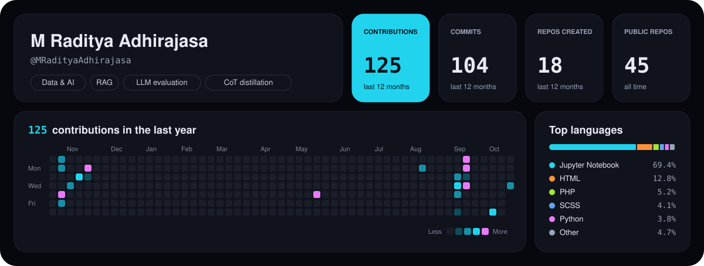

## Hey there! I'm Raditya

### About Me

- I work on data and AI, mostly LLM systems: retrieval-augmented generation, LLM-as-a-judge evaluation, and chain-of-thought distillation with QLoRA.
- I've built machine learning projects in speech emotion recognition, object detection with YOLOv8, Indonesian sentiment analysis, and air quality forecasting.
- On the data side I do engineering and analytics: Hadoop pipelines, ETL projects, and Streamlit dashboards.
- I've also built web apps with PHP and CodeIgniter 4.

### Tech Stack

**Languages**

  
  
  
  
  
  
  
  

**AI, Data & Frameworks**

  
  
  
  
  

  
  
  
  
  
  
  

**Tools**

  
  
  
  

### GitHub Analytics

### Connect with Me

  
  

